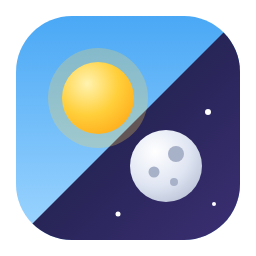

  

<h1 align="center">Constantini Theme</h1>

  Un aspecto claro y uno oscuro para Home Assistant, con un interruptor de sol y luna 
  al final de la barra lateral.

  <a href="README.md">English</a> · <a href="README.pt-BR.md">Português</a> · <b>Español</b>

---

## Qué incluye

- **Un tema, dos modos.** Tarjetas de cristal sobre un cielo suave: azul claro y melocotón de día, índigo profundo con un brillo de brasa de noche. Acento ámbar en ambos.
- **Un interruptor en la barra lateral.** El sol se desliza y se vuelve luna, las nubes se van y salen las estrellas. Funciona con la barra abierta, plegada y en el cajón del móvil.
- **Nada externo.** El fondo es CSS puro: no hay imagen que descargar y funciona sin internet.
- **Barra lateral editable.** El botón junto al interruptor abre la lista de elementos de la barra lateral: muévelos con las flechas, oculta lo que no usas y añade tus propios accesos directos a cualquier página de Home Assistant o dirección externa. Se guarda para tu usuario, en todos los dispositivos.
- **Tres idiomas.** Inglés, portugués (Brasil) y español.

## Instalación

1. En HACS, abre el menú, elige **Repositorios personalizados**, añade `https://github.com/constantini-ha/constantini-theme` como **Integración** e instala **Constantini Theme**.
2. Reinicia Home Assistant.
3. Ve a **Ajustes → Dispositivos y servicios → Añadir integración** y elige **Constantini Theme**. No hay nada que rellenar.

## Cómo se comporta

- El tema pasa a ser el predeterminado del claro y del oscuro cuando no se eligió otro. Un predeterminado que definiste con `frontend.set_theme` se respeta.
- El interruptor cambia el modo de **tu usuario**, en todos los dispositivos, igual que la página de perfil. Mientras no lo toques, cada dispositivo sigue el ajuste del sistema.
- Quitar la integración retira el tema y el interruptor.

## Solo el tema, sin la integración

Copia `custom_components/constantini_theme/themes/constantini.yaml` en tu carpeta `themes` y recarga los temas. Tendrás el aspecto, sin el interruptor.
