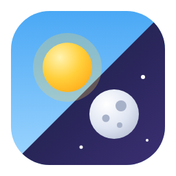

  

<h1 align="center">Constantini Theme</h1>

  A light and a dark look for Home Assistant, with a sun and moon switch 
  at the bottom of the sidebar.

  <b>English</b> · <a href="README.pt-BR.md">Português</a> · <a href="README.es.md">Español</a>

---

## What you get

- **One theme, two modes.** Glass cards over a soft sky: clear blue and peach by day, deep indigo with an ember glow by night. Amber accent in both.
- **A switch in the sidebar.** The sun slides across and becomes the moon, clouds leave and stars come out. It works with the sidebar open, collapsed, and in the phone drawer.
- **Nothing external.** The background is pure CSS, so there is no image to download and it works offline.
- **Three languages.** English, Portuguese (Brazil) and Spanish.

## Install

1. In HACS, open the menu, choose **Custom repositories**, add `https://github.com/constantini-ha/constantini-theme` as an **Integration**, and install **Constantini Theme**.
2. Restart Home Assistant.
3. Go to **Settings → Devices & services → Add integration** and pick **Constantini Theme**. There is nothing to fill in.

## How it behaves

- The theme becomes the default for light and dark when no other default was chosen. A default you set yourself with `frontend.set_theme` is left alone.
- The switch changes the mode for **your user**, on every device, the same way the profile page does. Until you touch it, each device follows its system setting.
- Removing the integration takes the theme and the switch away.

## Only the theme, without the integration

Copy `custom_components/constantini_theme/themes/constantini.yaml` into your `themes` folder and reload themes. You get the look, not the switch.
