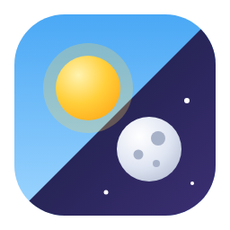

  

<h1 align="center">Constantini Theme</h1>

  Um visual claro e um escuro para o Home Assistant, com uma chave de sol e lua 
  no fim da barra lateral.

  <a href="README.md">English</a> · <b>Português</b> · <a href="README.es.md">Español</a>

---

## O que vem

- **Um tema, dois modos.** Cards de vidro sobre um céu suave: azul claro e pêssego de dia, índigo profundo com um brilho de brasa à noite. Destaque âmbar nos dois.
- **Uma chave na barra lateral.** O sol desliza e vira lua, as nuvens saem e as estrelas aparecem. Funciona com a barra aberta, recolhida e na gaveta do celular.
- **Nada externo.** O fundo é CSS puro: não há imagem para baixar e funciona sem internet.
- **Três idiomas.** Inglês, português (Brasil) e espanhol.

## Instalação

1. No HACS, abra o menu, escolha **Repositórios personalizados**, adicione `https://github.com/constantini-ha/constantini-theme` como **Integração** e instale **Constantini Theme**.
2. Reinicie o Home Assistant.
3. Vá em **Configurações → Dispositivos e serviços → Adicionar integração** e escolha **Constantini Theme**. Não há nada para preencher.

## Como se comporta

- O tema vira o padrão do claro e do escuro quando nenhum outro padrão foi escolhido. Um padrão que você definiu com `frontend.set_theme` é respeitado.
- A chave muda o modo do **seu usuário**, em todos os aparelhos, como a página de perfil faz. Enquanto você não tocar nela, cada aparelho segue a configuração do sistema.
- Remover a integração tira o tema e a chave.

## Só o tema, sem a integração

Copie `custom_components/constantini_theme/themes/constantini.yaml` para a sua pasta `themes` e recarregue os temas. Você fica com o visual, sem a chave.
